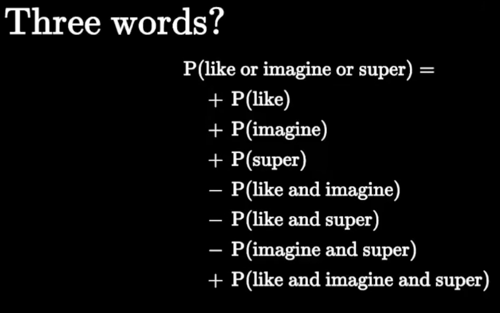
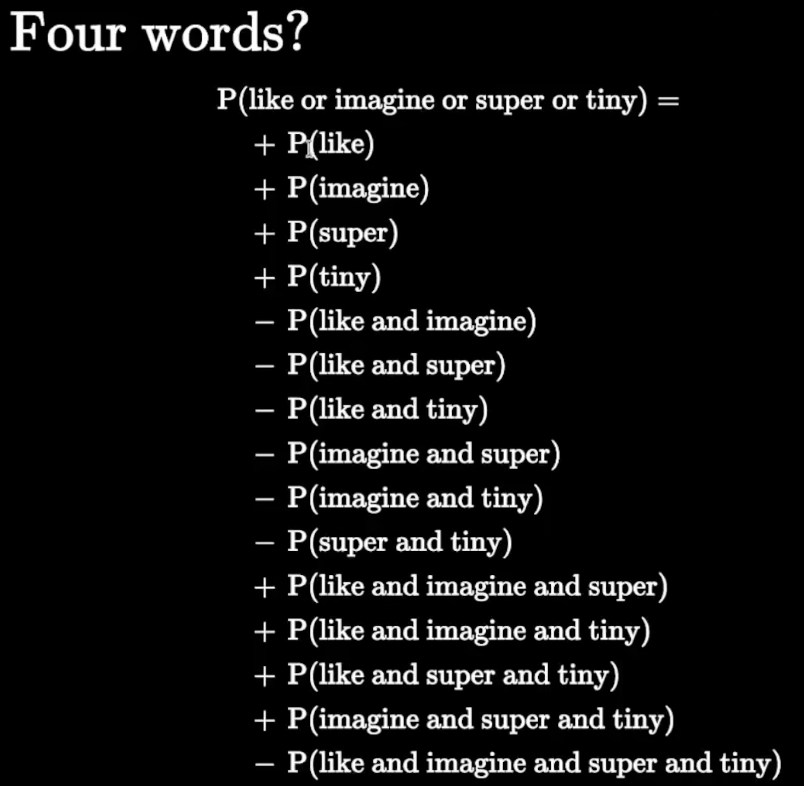
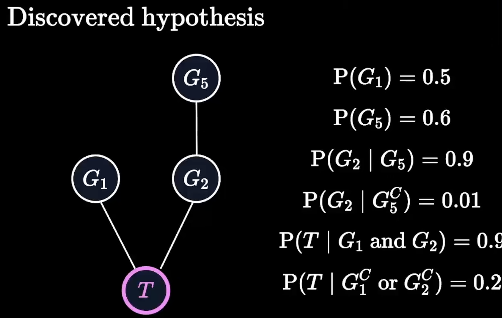
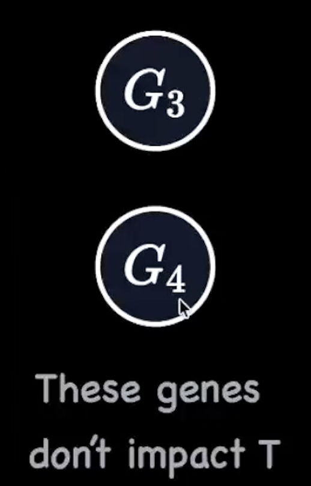
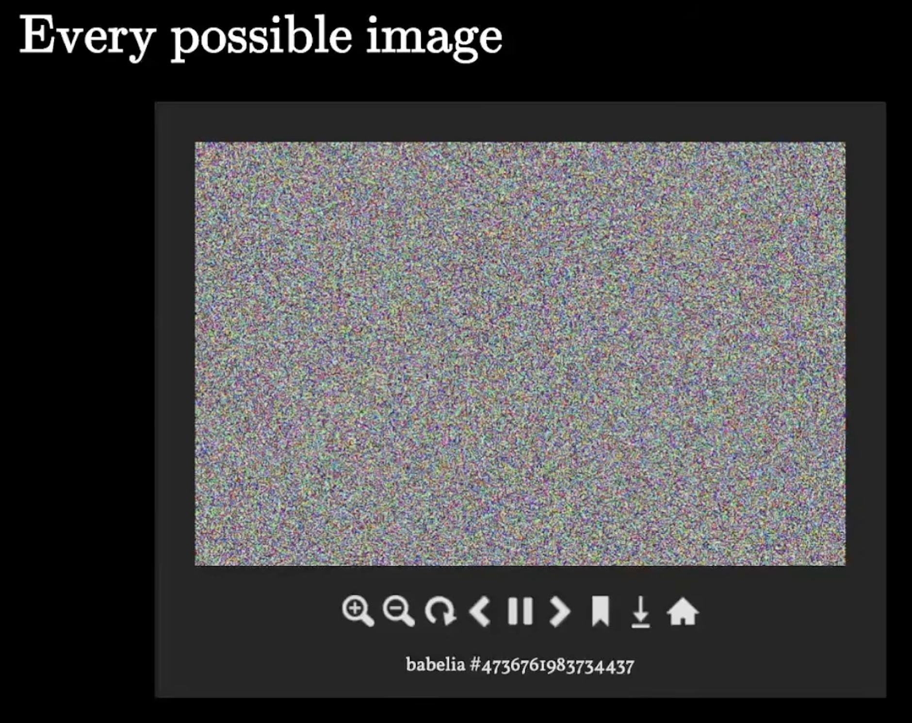
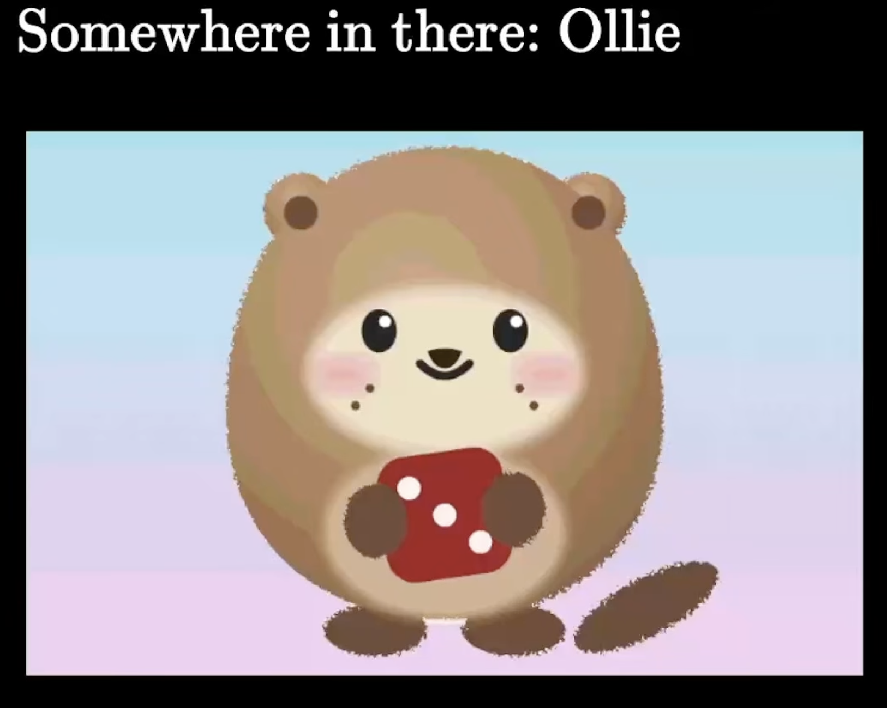
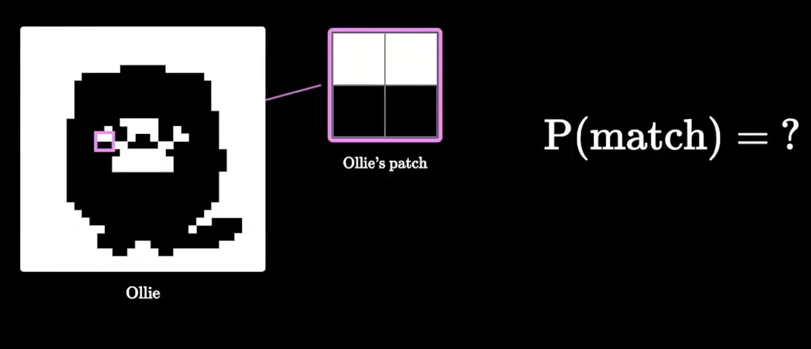
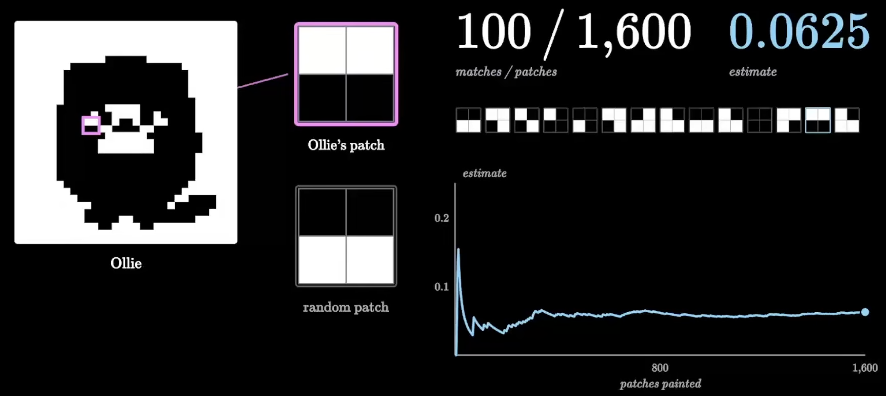

## [Axioms](https://www.youtube.com/watch?v=Q3ar5nFVuiQ)

probability has been a field for like hundreds and hundreds of years since people got addicted to gambling basically. but it wasnt until like 1900s that people realized it and proved it was actually a part of mathematics and people started to rigorously show why everything in probability was true. and there's this wonderful mathematician, his name is kolmogorov and he came up with what we called the axioms of probability. he said, "hey guys, if you assume these three things are true, I'm going to be able to prove every rule that you see in probability for AI". him and his friends were able to prove that. and it's true. mathematially, if you agree with these three things, I would be able to prove anything in probability theory just from these three assumptions

S = all ossible outcomes, E = the event

- **Axiom 1**: 0 ≤ P(E) ≤ 1

it says that if you have any event E, the probability of E, it's got to be between 0 and 1. you cant have a probability of 2 or a negative probability

- **Axiom 2**: P(S) = 1

if S is all possible outcomes in the universe, the probability of S is 1. so if you have some experiment and S is everything that could happen, the probability that something will happen is 1

- **Axiom 3**: if mutually exclusive, P(E or F) = P(E) + P(F)

Kolmogorov said, he's gonna assume that if you want to know the probability that E or F happens, and it's not possible for both E and F to occur at the same time, you can just add probabilities

P(E or F) = P(E) + P(F)

- **Complement**: the chance E does not happen, denoted by P(Ec)

P(E) + P(Ec) = 1
 
P(Ec) = 1 - P(E)

    - **Proof of Complement (Using Axioms)**: P(Ec) = 1 - P(E)

    P(E or Ec) = P(E) + P(Ec) [**A3**]
     
    P(S) = P(E) + P(Ec)
     
    1 = P(E) + P(Ec) [**A2**]
     
    P(Ec) = 1 - P(E)

- **Not Mutually Exclusive**: P(E or F) = P(E) + P(F) - P(E and F)

there's some outcomes where both E and F are happening. and if you thought about just counting outcomes, if you add up all the outcomes in E and all the outcomes in F, you're kind of double-counting these outcomes in the middle.

**Probability of >2 Events (OR)**

<table>
    <tr>
        <td></td>
        <td></td>
    </tr>
    <tr align="center">
        <td>Three Events</td>
        <td>Four Events</td>
    </tr>
</table>

**Conditional Paradigm**: All rules of probability hold when you condition

P(Ic) = 1 - P(I)
 
P(Ic|H) = 1 - P(I|H)

P(I or L) = P(I) + P(L) - P(I and L)
 
P(I or L|H) = P(I|H) + P(L|H) - P(I and L|H)

---

## [Independence](https://www.youtube.com/watch?v=7WmJvrnJh-U)

imagine that you're a biologist and you're trying to understand how different genes influence a trait. so whether or not something is shown and you're gonna give some data to an AI agent and you say "AI agent, I think some genes are influencing a trait. Can you figure out how?" and to the AI agent, you give a whole bunch of data. so all of this data comes from bats. and you have a 100,000 bats. for every single bat, you know whether or not the bat has gene one, gene two, ..., gene 5 and you know if it has the trait you care about, like whether it could carry a particular disease. so you have these six observations per bat and you have a 100,000 bats. you send it to your AI agent. Your AI agent pours over the data and it comes back to you with this answer. it says, "biologist, i think i undersatnd how these genes influence this trait. i think gene three and gene four dont influence the trait at all. but i do think that if the bat has gene five, they're more likely to have gene two. and if they have gene one and gene two, that's what influences whether or not they show the trait. and it comes up with the whole probability explanation for why this hypothesis is true.

<table>
    <tr>
        <td></td>
        <td></td>
    </tr>
</table>

we know, P(E|F) = P(E and F) / P(F)

**Chain Rule (defn.)**
P(E and F) = P(E|F) • P(F)

<table>
    <tr>
        <td></td>
        <td></td>
    </tr>
    <tr align="center">
        <td>640x416, 4096 colors each</td>
        <td>P(Ollie) = ?</td>
    <tr>
</table>

here's a 640x416 pixel image, so here's a picture. each pixel was generated randomly and we've generated a whole bunch of these. every single could be one of 4,096 colors. and the thing that they said was so interesting about this art piece is that inside here, you might find any pciture like since each pixel is generated randomly it's possible that you get this picture but it's also possible you would've generated this beautiful image of Ollie. it's possible that somewhere in this database of randomly chosen pixels, there is this exact image. if you picked an image at random, what is the chance that all those colored pixels would be exactly this one? like, i know it's small but can we figure out exactly how small?

<table>
    <tr>
        <td></td>
        <td></td>
    </tr>
    <tr align="center">
        <td>4 pixels, black or white</td>
        <td>1600 simulations</td>
    <tr>
</table>

imagine everything's black and white and we're just going to take a little bit of a Ollie's cheek. so, in this little piece of an image, let's say we've 2x2 pixels, so four pixels. top two are white and bottom two are black. i'm going to start with an easier question. if we generate 2x2 pixel grid, what's the chance I would get an exact match to this 2x2 pixel grid? so, if i generate random pixel grids where each pixel can be black or white, what's the chance that I get two white on the top and two black on the bottom? so if i repeat this process 1,600 times, 100 of those times I got exactly two whites and two blacks. 100/1600 ≈ 1/16 ≈ 0.0625

but there's a way to figure this out without simulation. if i said whats the probability of you matching excatly? if i wanna get a 2x2 grid to exactly match,
i first need the top left pixel to exactly match = 1/2
then bottom left = 1/2
then top right = 1/2
and finally bottom left = 1/2

1/2 • 1/2 • 1/2 • 1/2 = 1/16

but how come we get to multiply these probabilities? like how come we got to decompose this problem of does this whole picture match into just thinking about each of the pixels on they own?

**Independence**
Two events A and B are called independent if:
P(A|B) = P(A)

above equation is saying that, on the right side, is your belief that A happens and on the left side is your belief that A happens if I told you B occured. the fact that they're equal means something important. it means that knowing B didnt change your belief that A would occur. that's what independence mean, knowing one event doesn't change your belief in the other event. if this is not true, you call events **dependent**

if A and B are independent:
 
 
P(A and B) = P(A|B) • P(B) [chain rule]
 
P(A|B) = P(A) [independence rule]
 
 
P(A and B) = P(A) • P(B)

what is the chance of you generating exactly this picture of Ollie? well, lets take the first few pixels. if you generated a random picture and you chose one pixel, there's 4096 colors to pick from and the chance you chose exactly mine is exactly 1 in 4096. equally likely outcome thing. so, the chance of getting the first pixel right is very small. it's about 1 in 4096. but if you asked not what's the chance that you get the first pixel right but what's the chance you get all 640x416 = 266,240 pixels right?

P(one pixel right) = 1/4096
 
P(Ollie) = (1/4096)266,240 ≈ **1.9 x 10-961,755**
 
 

each pixel moves the decimal point about 3.6 places.

**Truths about Independence**

1. if A is independent of B, B is independent of A
2. if A is independent of B, A is also independent of Bc

### Problem 1

you flip two frisbees. each lands "heads" with probability 0.6, independently. the frisbees are "even" if both land heads or both land tails. what is the probability that the frisbees are even?

**Solution**

P(even) = P(both heads or both tails)
 
 
H1 = frisbee 1 is heads
H2 = frisbee 2 is heads
 
 
T1 = frisbee 1 is tails
T2 = frisbee 2 is tails
 
 
OR → are they mutually exclusive? → YES (both heads and both tails can't occur at the same time)
 
P((H1 and H2) or (T1 and T2))
 
P(H1 and H2) + (T1 and T2)
 
P(H1) x P(H2) + P(T1) x P(T2)
 
(0.6 x 0.6) + ((1 - 0.6) x (1 - 0.6)) = 0.36 + 0.16 = **0.52**

### Problem 2

a self-driving car has lidar, radar and camera. each sensor fails independently with probability 0.01. what is the chance at at least one sensor is working?

**Solution**

P(failure) = 0.01
 
P(success) = 0.99
 
 
P(at least one works) = P(L or R or CM) → are they mutually exclusive? → NO
 
P(at least one works) = 1 - P(all three fail) = 1 - (Lc and Rc and CMc)
 
1 - (0.01 x 0.01 x 0.01) = 1 - 0.000001 ≈ **0.999999**

### Problem 3

why is the internet so reliable? like why is it so consistent that i can get to google? the answer is there's lots of paths between your computer and google's computer. so you you might not know this but there's routers in the internet. let's say each path is represented by one router. assume that i tell you the probability that this router works is P1. i'm not going to bother with saying what P1 is. i'm using use variable but that's like some number. it could be 0.01, could be 0.5. there's some probability that router 1 works. there is some probability that router two works and there's some probability that router n works. to send a message from A to B, you dont need all of them to work. you need at least one path to exist. so whats the probability that there's atleast one path from A to B?

**Solution**

n independent routers
 
Ri: router i works
 
P(Ri) = pi>
 
E: a path from A to B works
 
 
P(at least one route goes from A to B) = 1 - P(no path goes from A to B)
 
1 - P(R1c and R2c and ... and Rnc and)
 
1 - P(R1c) x P(R2c) ... P(Rnc)
 
1 - [1 - p1] x [1 - p2] ... [1 - pn]
 
1 - ∏i = 1 n  (1 - pi)

---

## [Bayes Theorem]()

---

## [Lecture]()

If I give a LLM the exact same prompt twice, should I expect the same answer? Is it a bug or a feature?
